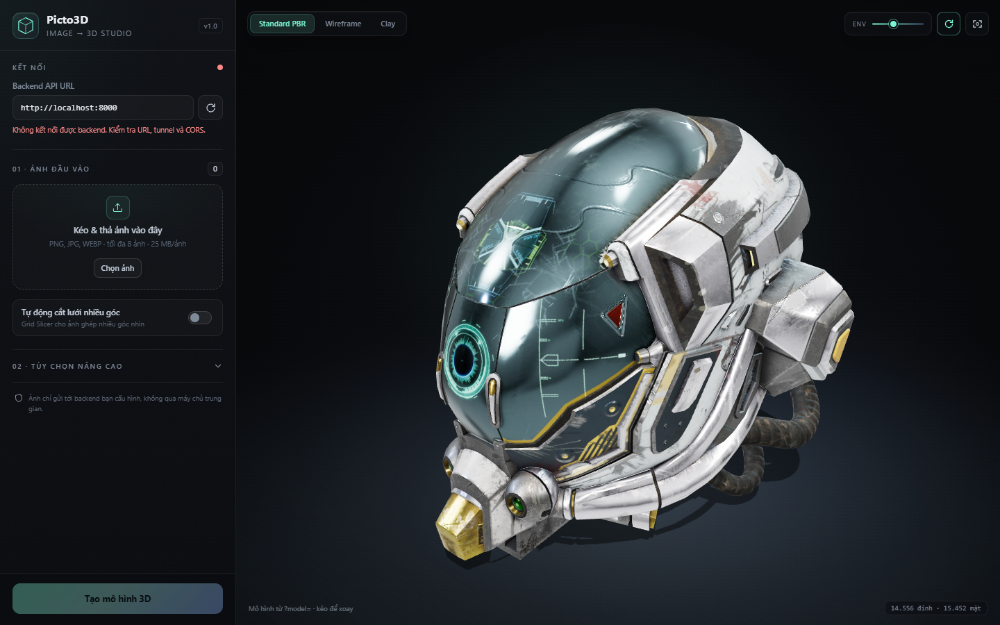

# Picto3D — Image → 3D Studio

Hệ thống biến **ảnh 2D thành mô hình 3D `.glb`** chạy end-to-end:

- **Backend**: FastAPI + TripoSR + rembg, chạy trên GPU Google Colab (T4) và mở
  public bằng cloudflared/ngrok.
- **Frontend**: Vite + TypeScript + Three.js, studio 3D tối màu với upload ảnh,
  Grid Slicer, theo dõi tiến trình và tải GLB.



> Ảnh xem trước dùng model demo **Damaged Helmet** của Khronos (CC BY 4.0 / CC BY-NC 4.0).

## Tính năng

| Nhóm | Chi tiết |
|---|---|
| Nhận ảnh | 1–8 ảnh PNG/JPG/WEBP, kéo thả, xem trước, xoá từng ảnh |
| Grid Slicer | Cắt ảnh ghép nhiều góc thành 2×2 … 4×4 ô, chọn ô bằng click |
| Xử lý | Tách nền rembg, căn giữa vật thể ở tỉ lệ 80%, nền xám trung tính |
| Dựng 3D | TripoSR marching cubes (128–384), vertex color, decimate 10k–100k mặt |
| Hậu kỳ | Làm sạch lưới, Taubin smooth, chuẩn hoá Y-up, xuất GLB |
| Theo dõi | Upload progress + job polling, 4 bước và thanh tiến trình |
| Viewer | ACES Filmic, RoomEnvironment IBL, 3-point light, bóng mềm, auto-fit camera |
| Chế độ | Standard PBR · Wireframe · Clay/Matcap, slider ENV, auto-rotate, reset camera |
| Vận hành | Tự xoá file theo TTL, `torch.cuda.empty_cache()` sau mỗi job, health check |

## Kiến trúc

```
┌────────────────────────────┐        HTTPS (cloudflared / ngrok)        ┌──────────────────────────────┐
│  Picto3D Studio (Vite)     │  ───────────────────────────────────────▶ │  FastAPI trên Colab GPU      │
│  Three.js · TypeScript     │                                           │                              │
│                            │  ◀── GLB qua /files/... ────────────────  │  rembg → TripoSR → mesh ops  │
└────────────────────────────┘                                           └──────────────────────────────┘
```

Luồng xử lý phía backend:

```
ảnh upload
  → decode + EXIF + resize 2048 px
  → rembg (ISNet / BiRefNet) → alpha cutout
  → chấm điểm & chọn góc nhìn tốt nhất (TripoSR là single-image)
  → căn giữa, foreground ratio 0.8, nền xám 127, 512×512
  → TripoSR (marching cubes 256) → mesh + vertex color
  → clean → Y-up → decimate ~40k mặt → Taubin smooth → feet at Y=0
  → GLB → /files/picto3d_<job>.glb
  → gc.collect() + torch.cuda.empty_cache()
```

## Bắt đầu nhanh

### 1. Backend trên Google Colab

1. Mở [Google Colab](https://colab.research.google.com), chọn
   **Runtime → Change runtime type → T4 GPU**.
2. Mở `backend/colab/Picto3D_Backend.ipynb` trên Colab. Notebook tự clone
   [`longtran592005/picto3d`](https://github.com/longtran592005/picto3d) về
   `/content/picto3d` (không cần upload thư mục dự án).
3. Chạy lần lượt các cell:
   - kiểm tra GPU (`nvidia-smi`);
   - clone/cập nhật mã nguồn từ GitHub;
   - cài dependencies (`requirements-colab.txt`);
   - cài `torchmcubes` (tự fallback sang PyMCubes nếu build lỗi);
   - clone TripoSR vào `/content/TripoSR`;
   - chạy `colab_launch.py`.
4. Cell cuối in ra URL dạng:

   ```
   ╔══════════════════════════════════════════════════╗
   ║ PICTO3D API ĐÃ SẴN SÀNG                          ║
   ║ API URL : https://xxxx-xxxx.trycloudflare.com    ║
   ╚══════════════════════════════════════════════════╝
   ```

   Lần đầu sẽ tải model TripoSR (~1.5 GB) và model tách nền (~170 MB).

> Giữ tab Colab mở trong suốt quá trình dùng. Quick tunnel đổi URL sau mỗi lần
> khởi động lại — chỉ cần dán URL mới vào web.

Chi tiết backend, biến môi trường và chạy trên Linux GPU: [`backend/README.md`](backend/README.md).

### 2. Frontend trên máy local

Yêu cầu **Node.js 20+**.

```bash
cd frontend
npm install
npm run dev
```

Mở <http://localhost:5173>, dán **API URL** vừa lấy từ Colab vào ô
**Backend API URL** ở sidebar rồi bấm nút kiểm tra kết nối.

Không có backend vẫn xem được giao diện:

```
http://localhost:5173/?model=/demo/damaged-helmet.glb
```

Chi tiết frontend, cấu hình build và troubleshooting: [`frontend/README.md`](frontend/README.md).

### 3. Sử dụng

1. Kéo thả 1 hoặc nhiều ảnh của cùng một vật thể.
2. Nếu là **một ảnh ghép nhiều góc**, bật **Grid Slicer**, chọn lưới và click
   các ô muốn dùng.
3. Chọn chất lượng lưới (marching cubes) và số mặt mục tiêu.
4. Bấm **Tạo mô hình 3D** → theo dõi tiến trình → mô hình hiện trong studio.
5. Chuyển **PBR / Wireframe / Clay**, chỉnh ENV, xoay/zoom bằng chuột.
6. Bấm **Tải GLB** để lưu file.

## API

| Endpoint | Mô tả |
|---|---|
| `POST /api/reconstruct` | Upload ảnh. Mặc định trả kết quả; `?wait=false` trả job để polling |
| `GET /api/jobs/{id}` | Trạng thái job: `queued → preprocess → inference → mesh → export → done` |
| `GET /api/download/{id}` | Tải GLB kèm `Content-Disposition: attachment` |
| `GET /files/{name}` | File GLB tĩnh (dùng cho viewer) |
| `GET /api/health` | GPU, VRAM, model đã nạp chưa, độ sâu queue |
| `GET /docs` | Swagger UI |

Ví dụ:

```bash
curl -X POST "http://localhost:8000/api/reconstruct?wait=false" \
  -F "files=@front.png" \
  -F "foreground_ratio=0.8" \
  -F "mc_resolution=256" \
  -F "target_faces=40000"
```

Kết quả rút gọn:

```json
{
  "job_id": "8f3a1c2b9d10",
  "status": "completed",
  "glb_url": "https://xxx.trycloudflare.com/files/picto3d_8f3a1c2b9d10.glb",
  "download_url": "https://xxx.trycloudflare.com/api/download/8f3a1c2b9d10",
  "elapsed_seconds": 14.8,
  "vertices": 20482,
  "faces": 40000,
  "input_views": 2,
  "selected_view": 1,
  "device": "cuda"
}
```

## Cấu trúc dự án

```
picto3d/
├── backend/
│   ├── app.py                 # FastAPI, CORS, routes, static files
│   ├── colab_launch.py        # uvicorn + cloudflared/ngrok + health wait
│   ├── colab/Picto3D_Backend.ipynb
│   ├── requirements*.txt
│   └── picto3d/
│       ├── preprocessing.py   # decode, rembg, framing, scoring
│       ├── engines/           # interface + TripoSR wrapper
│       ├── mesh_ops.py        # clean, decimate, smooth, GLB
│       ├── pipeline.py        # orchestration, progress, VRAM release
│       ├── jobs.py            # job store thread-safe + TTL
│       └── ...
├── frontend/
│   ├── src/core/StudioScene.ts
│   ├── src/utils/ImageSlicer.ts
│   ├── src/services/ApiClient.ts
│   ├── src/main.ts
│   └── public/demo/
├── docs/preview.png
└── .gitignore
```

## Giới hạn đã biết

- **TripoSR là single-image**: khi upload nhiều ảnh, backend chấm điểm và chỉ
  dựng từ góc tốt nhất (`selected_view`). Muốn fusion thật sự nhiều góc, thay
  engine qua interface `ReconstructionEngine` (ví dụ InstantMesh).
- **Vertex color, không bake texture UV**: ổn định và nhẹ hơn cho web, nhưng độ
  chi tiết bề mặt thấp hơn texture đầy đủ.
- **Không có xác thực**: phù hợp demo/NCKH. Quick tunnel công khai nghĩa là ai
  có URL cũng dùng được GPU của bạn.
- **File tạm**: GLB tự xoá sau `PICTO3D_FILE_TTL` giây (mặc định 1 giờ). Tải về
  máy nếu cần giữ.
- **CPU rất chậm**: TripoSR cần GPU; `device=cpu` chỉ để thử pipeline.

## Troubleshooting

| Hiện tượng | Nguyên nhân / cách xử lý |
|---|---|
| Web báo không kết nối được backend | Tunnel đã đóng hoặc URL cũ; mở `<API>/api/health` để kiểm tra |
| Lỗi CORS | URL sai scheme/port; backend phải chạy và trả `Access-Control-Allow-Origin: *` |
| `Không tìm thấy mã nguồn TripoSR` | Chưa clone vào `/content/TripoSR`; hoặc đặt `PICTO3D_TRIPOSR_PATH` |
| CUDA OOM | Giảm `mc_resolution` (192), `target_faces` (30k), `PICTO3D_CHUNK_SIZE=4096`; restart runtime |
| `torchmcubes` build lỗi | Notebook tự cài PyMCubes fallback (chậm hơn nhưng vẫn chạy) |
| Ảnh tách nền bị mất chi tiết | Thử ảnh nền tương phản hơn, hoặc tắt **Tách nền** nếu ảnh đã có alpha |
| GLB tải về nhưng viewer trống | Kiểm tra `glb_url` trả 200, có CORS; thử `?model=<glb_url>` |
| Trang HTTPS không gọi được API HTTP | Trình duyệt chặn mixed content; dùng HTTPS cho cả hai (cloudflared) |

## Bảo mật

Cấu hình mặc định `allow_origins=["*"]` và tunnel công khai chỉ phù hợp **demo**.
Nếu triển khai lâu dài:

- thêm API key hoặc reverse proxy có xác thực;
- giới hạn `allow_origins` theo domain frontend;
- giới hạn số ảnh/kích thước và đặt hạn mức GPU;
- không chia sẻ URL tunnel ra ngoài.

## Ghi công

- [TripoSR](https://github.com/VAST-AI-Research/TripoSR) — MIT, Stability AI / VAST AI Research.
- [rembg](https://github.com/danielgatis/rembg) — MIT, Daniel Gatis.
- [Three.js](https://threejs.org/) — MIT.
- [Vite](https://vite.dev/) — MIT.
- [Damaged Helmet](https://github.com/KhronosGroup/glTF-Sample-Assets/tree/main/Models/DamagedHelmet)
  — © theblueturtle_ (CC BY-NC 4.0) / ctxwing (CC BY 4.0), chỉ dùng cho demo.

Dự án phục vụ mục đích học tập và nghiên cứu (NCKH).
