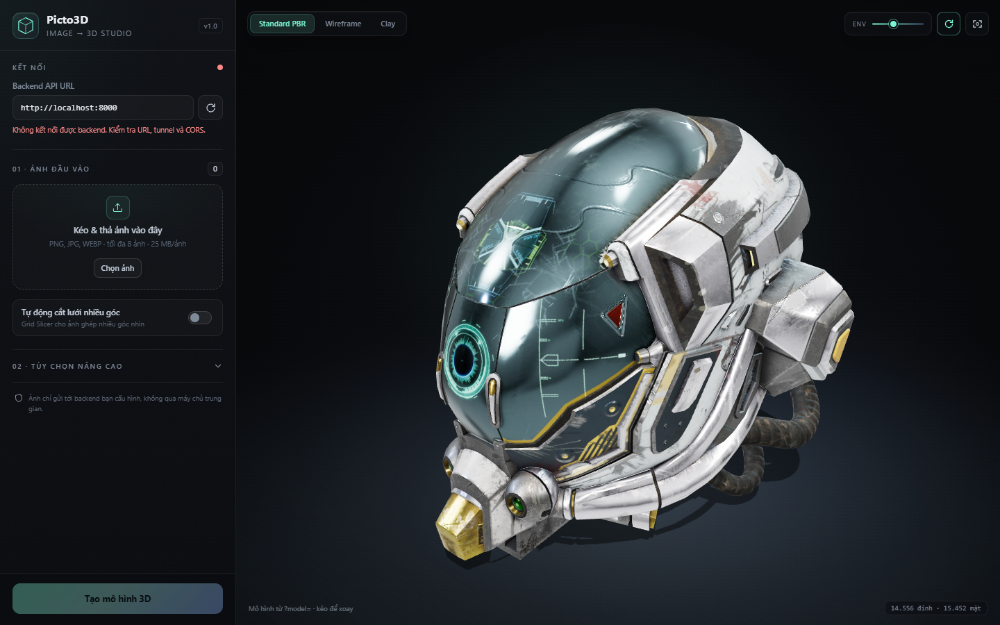

# Picto3D Studio — Web Viewer

Giao diện **Vite + TypeScript + Three.js** để tải ảnh lên, cắt lưới nhiều góc nhìn,
gọi backend Picto3D và hiển thị mô hình GLB trong một studio 3D.



## Yêu cầu

- Node.js **20+** (đã kiểm tra với Node 24.15 và npm 11.12)
- Backend Picto3D đang chạy (Colab + cloudflared, xem `../backend/README.md`)

## Chạy nhanh

```bash
cd frontend
npm install
npm run dev
```

Mở <http://localhost:5173>. Nếu backend chạy ở máy khác, dán URL tunnel vào ô
**Backend API URL** ở sidebar (giá trị được lưu vào `localStorage`).

Không có backend? Bấm **Xem demo** hoặc mở trực tiếp:

```
http://localhost:5173/?model=/demo/damaged-helmet.glb
```

`?model=` nhận URL tuyệt đối hoặc tương đối, hữu ích để kiểm tra nhanh một file GLB.

## Cấu hình

| Cách | Giá trị |
|---|---|
| Mặc định | `http://localhost:8000` |
| File `.env` | `VITE_API_URL=https://xxx.trycloudflare.com` (xem `.env.example`) |
| Biến môi trường khi build | `VITE_API_URL=https://xxx.trycloudflare.com npm run build` |
| Trong giao diện | ô **Backend API URL**, lưu ở key `picto3d.apiUrl` |

URL không có scheme được tự thêm `https://`; riêng `localhost`/`127.0.0.1` dùng
`http://`. Dấu `/` ở cuối được tự bỏ.

## Scripts

```bash
npm run dev        # dev server + HMR, host LAN
npm run typecheck  # tsc --noEmit (strict, không dùng any)
npm run build      # typecheck + build production vào dist/
npm run preview    # xem bản build
```

`dist/` là site tĩnh, có thể deploy lên Vercel/Netlify/Cloudflare Pages.
Nhớ cấu hình `VITE_API_URL` trỏ tới backend HTTPS.

## Tính năng

- **Upload**: kéo thả hoặc chọn PNG/JPG/WEBP, tối đa 8 ảnh (theo `max_images`
  của backend), xem trước thumbnail, xoá từng ảnh.
- **Grid Slicer**: một ảnh ghép nhiều góc nhìn → chọn lưới 2×2 … 4×4, click từng ô
  để bật/tắt, cắt thành các file riêng trước khi gửi.
- **Theo dõi job**: upload progress + polling `GET /api/jobs/{id}`, thanh tiến trình
  và 4 bước `preprocess → inference → mesh → export`.
- **Studio viewer**: ACES Filmic tone mapping, RoomEnvironment IBL, key/fill/rim
  light, bóng đổ mềm, tự căn camera theo `Box3`, OrbitControls có damping.
- **Chế độ hiển thị**: Standard PBR, Wireframe, Clay/Matcap; slider cường độ
  environment; tự động xoay; nút căn lại camera.
- **Kết quả**: số đỉnh/mặt, thời gian xử lý, góc nhìn được chọn, tải GLB về máy.

## Luồng gọi API

```
POST /api/reconstruct?wait=false   multipart: files[], foreground_ratio,
                                   mc_resolution, target_faces, remove_background
        │ 202 { job_id, status: "queued", ... }
        ▼
GET /api/jobs/{job_id}             poll ~550–1200 ms
        │ completed { result: { glb_url, download_url, ... } }
        ▼
GLTFLoader.load(glb_url)           hiển thị trong studio
GET /api/download/{job_id}         tải file kèm Content-Disposition
```

Backend trả thẳng kết quả nếu gọi `wait=true` (không query) — `ApiClient` xử lý cả hai.

## Cấu trúc

```
frontend/
├── index.html                 # markup sidebar + viewer
├── src/
│   ├── main.ts                # state, upload, slicer, API flow, sự kiện UI
│   ├── styles.css             # dark studio theme, responsive
│   ├── types.ts               # interface dùng chung, không any
│   ├── core/
│   │   ├── StudioScene.ts     # renderer, IBL, lights, modes, camera fit
│   │   └── textures.ts        # matcap + ground glow procedural
│   ├── services/
│   │   └── ApiClient.ts       # XHR upload, polling, validators, download
│   └── utils/
│       └── ImageSlicer.ts     # Canvas grid preview + slice
└── public/
    ├── favicon.svg
    └── demo/damaged-helmet.glb
```

## Lưu ý

- **CORS**: backend đã bật `allow_origins=["*"]`. Nếu đổi sang proxy riêng, cần
  cho phép origin của frontend và expose `Content-Disposition`.
- **Mixed content**: trang chạy HTTPS không gọi được API `http://` (trừ
  `localhost`). Dùng tunnel HTTPS cho cả hai.
- **Tunnel đổi URL**: cloudflared quick tunnel cấp URL mới mỗi lần khởi động —
  dán lại URL trong sidebar.
- **Ảnh nhiều góc**: TripoSR là single-image; backend chấm điểm và chọn góc tốt
  nhất. Response có `input_views` và `selected_view`.
- **Demo GLB**: Damaged Helmet chỉ dùng cho mục đích minh hoạ (CC BY 4.0 /
  CC BY-NC 4.0) — xem `public/demo/README.md` trước khi dùng thương mại.

## Troubleshooting

| Hiện tượng | Cách xử lý |
|---|---|
| “Không kết nối được backend” | Kiểm tra tunnel còn sống, mở `<API>/api/health` trên trình duyệt |
| Lỗi CORS trên console | URL sai scheme/port, hoặc backend chưa chạy |
| Upload mãi không xong | Ảnh quá lớn (>25 MB) hoặc mạng chậm; thử JPG nhỏ hơn |
| GLB tải về nhưng viewer trống | Kiểm tra Network: `glb_url` phải trả 200 và có CORS |
| WebGL không khởi động | Bật hardware acceleration; kiểm tra `chrome://gpu` |

## Tham khảo

- [Three.js](https://threejs.org/) — MIT
- [Vite](https://vite.dev/) — MIT
- [Damaged Helmet](https://github.com/KhronosGroup/glTF-Sample-Assets/tree/main/Models/DamagedHelmet) — CC BY 4.0 / CC BY-NC 4.0
